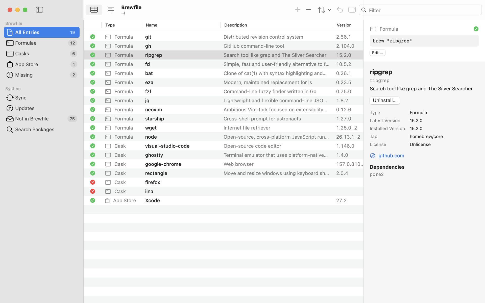
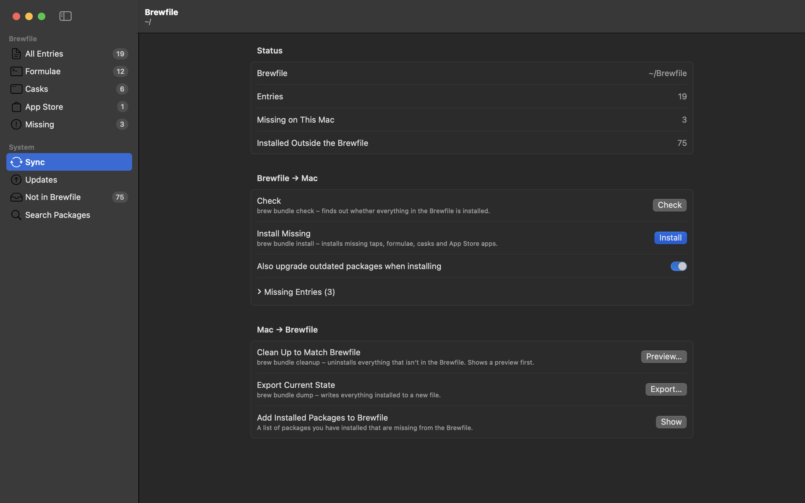
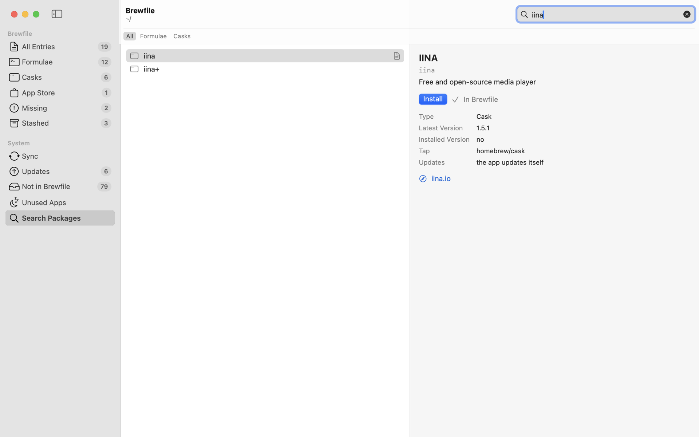
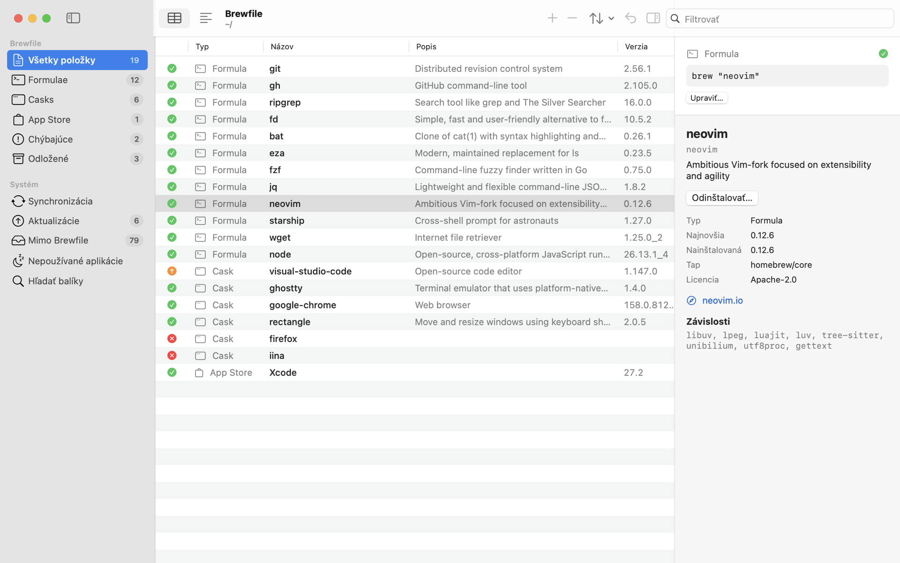

# Brew GUI

[](LICENSE)

A native macOS app (SwiftUI) for managing Homebrew packages and your Brewfile.
Available in English and Slovak (follows the macOS language setting).

<picture>
  <source media="(prefers-color-scheme: dark)" srcset="docs/screenshots/brewfile-dark.png">
  
</picture>

## Download

With Homebrew:

```bash
brew install --cask furcenzo/tap/brew-gui
```

or in a Brewfile:

```ruby
tap "furcenzo/tap"
cask "furcenzo/tap/brew-gui", trusted: true
```

Updates come with `brew upgrade`.

Or get the latest **Brew-GUI-x.y.z.zip** from [Releases](https://github.com/Furcenzo/brew-gui/releases/latest)
(universal app for Apple silicon and Intel, macOS 15 or later), unzip it and move **Brew GUI.app** to
/Applications.

Either way, the app is not notarized by Apple, so macOS may refuse to open it. If that happens, open
**System Settings → Privacy & Security** and click **Open Anyway** next to “Brew GUI”, or run:

```bash
xattr -dr com.apple.quarantine "/Applications/Brew GUI.app"
```

If the app opens normally, there's nothing else to do.

## Features

- **Brewfile** – a table of every `tap` / `brew` / `cask` / `mas` / … entry with its status
  (installed, missing, outdated), description and version; filtering by type, search,
  duplicate highlighting. Add / edit / remove entries, sort the file, plain-text mode.
  Comments, blank lines and unrecognized Ruby code are preserved untouched when saving.
- **Sync** – `brew bundle check`, `install` (optionally without upgrading),
  `cleanup` with a preview before anything is uninstalled, `dump` to a new file.
- **Updates** – `brew outdated` (including `--greedy`), upgrade selected packages or everything, `brew update`.
  `brew update` also runs automatically at launch and when you return to the app after it has been in the
  background for a while (5–60 minutes, set in Settings ⌘,).
- **Not in Brewfile** – packages, taps and App Store apps installed outside your Brewfile; add them with one click.
  The *Apps* tab lists apps installed by hand (not via Homebrew or the App Store), finds a matching cask and lets
  Homebrew adopt them (`brew install --cask --adopt`) or reinstall them from the cask.
- **Search** – instant search across all formulae and casks with details (`brew info`).
  Installing a package offers to add it to the Brewfile too, uninstalling offers to remove it (applied only
  after `brew` succeeds).
- **Console** – live output of every operation, with the option to stop it, and a history.
- **Menu bar** – the number of available updates, a quick `brew update` / upgrade, package search and the apps
  installed with Homebrew to launch; Brew GUI keeps running there when its window is closed (can be turned off in
  Settings). Turn on *Open at login* in Settings to have it there after every login.

Brewfile changes are saved automatically; undo the last edit with ⌘Z (Edit → Undo).
Before the first save in each session, the original file is backed up to `~/Library/Application Support/BrewGUI/Backups`.
If another program changes the Brewfile in the meantime, the app asks whether to reload it or overwrite it.
The state of installed packages is refreshed every time you switch to the app (at most once every 10 s), after each
operation, and manually with ⌘R – so it also picks up a `brew install` run in Terminal.
If a cask needs an administrator password, a system dialog is shown (via `SUDO_ASKPASS`).

## Screenshots

| Sync | Search |
|---|---|
|  |  |

| Slovak |
|---|
|  |

The screenshots use the sample [docs/screenshots/Brewfile](docs/screenshots/Brewfile); regenerate them with
`./scripts/screenshots.sh`.

## Requirements

- macOS 15 or later
- [Homebrew](https://brew.sh)
- Swift 6 toolchain (Xcode 16 or later) to build from source

## Running

```bash
swift run BrewGUI
```

Build a standalone app into `build/Brew GUI.app`:

```bash
./scripts/build-app.sh
```

Tests:

```bash
swift test
```

`swift run` always shows the English UI (there is no app bundle); to try another language, run the built app with
`"build/Brew GUI.app/Contents/MacOS/BrewGUI" -AppleLanguages '(sk)'`.

## Translations

Texts in the code are English; translations live in `Sources/BrewGUI/Resources/<language>.lproj/Localizable.strings`
(the key is the English text). After changing any user-facing text, run:

```bash
./scripts/check-localization.sh
```

It fails when a text has no translation or when non-English text ends up in the code. To run it automatically
before every commit, enable the bundled git hook once per clone:

```bash
git config core.hooksPath .githooks
```

See [CLAUDE.md](CLAUDE.md) for the detailed rules (they also apply to Claude Code, which runs the check through a
project hook).

## Releasing

```bash
./scripts/release.sh 0.2.0
```

builds a universal app and `build/Brew-GUI-0.2.0.zip`; adding `--publish` also tags `v0.2.0`, creates the
GitHub Release (using the `## 0.2.0` section of [CHANGELOG.md](CHANGELOG.md) as its release notes) and updates the
cask in [Furcenzo/homebrew-tap](https://github.com/Furcenzo/homebrew-tap).

## Project structure

- `Sources/BrewCore` – Brewfile parser, process runner, wrapper around the `brew` CLI (no UI, tested).
- `Sources/BrewGUI` – the SwiftUI app (`AppModel` + screens); `Resources/*.lproj` – translations.
- `Tests/BrewCoreTests` – tests for the parser and the process runner.
- `scripts/` – app bundle build, release, translation check and the Claude Code hook;
  `scripts/icon/` – the app icon is drawn in code (`AppIcon.swift`), `make-icon.sh` rebuilds `AppIcon.icns`.

## Debugging

`BREWGUI_SNAPSHOT=/path.png [BREWGUI_PAGE=sync|outdated|unmanaged|apps|search|missing|casks|check]`
saves an image of the window once loaded and quits the app (useful without screen recording permission).
`BREWGUI_FILE=/path/to/Brewfile` opens a different file, `BREWGUI_DEBUG_ADD=name [BREWGUI_DEBUG_UNDO=1]`
simulates adding an entry (and ⌘Z) – only test this on a copy of your Brewfile.
`BREWGUI_APPS_DIRS=/dir1:/dir2` scans other folders instead of /Applications and ~/Applications.
`BREWGUI_PAGE=menubar` captures the menu bar panel (`BREWGUI_MENUBAR_QUERY=<text>` types into its search field).
For screenshots: `BREWGUI_APPEARANCE=light|dark`, `BREWGUI_WINDOW_SIZE=1280x800`, `BREWGUI_SELECT=<entry>`
(selects it in the Brewfile table), `BREWGUI_SEARCH=<package>` (opens it in Search) and
`BREWGUI_DISPLAY_PATH=~/Brewfile` (path shown instead of the real one).

## License

Copyright (C) 2026 Furcenzo

This program is free software: you can redistribute it and/or modify it under the terms of the
[GNU General Public License](LICENSE) as published by the Free Software Foundation, either version 3
of the License, or (at your option) any later version (`GPL-3.0-or-later`).
This program is distributed in the hope that it will be useful, but WITHOUT ANY WARRANTY.
See the [LICENSE](LICENSE) file for the full text.
